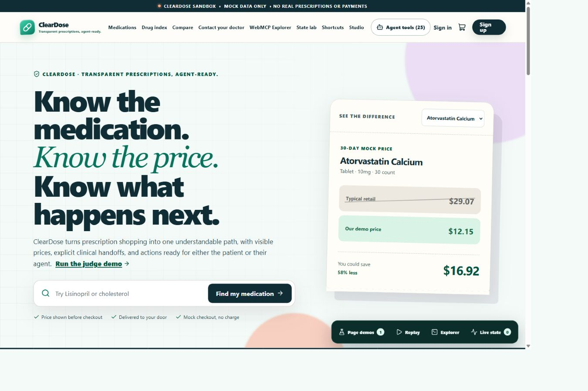
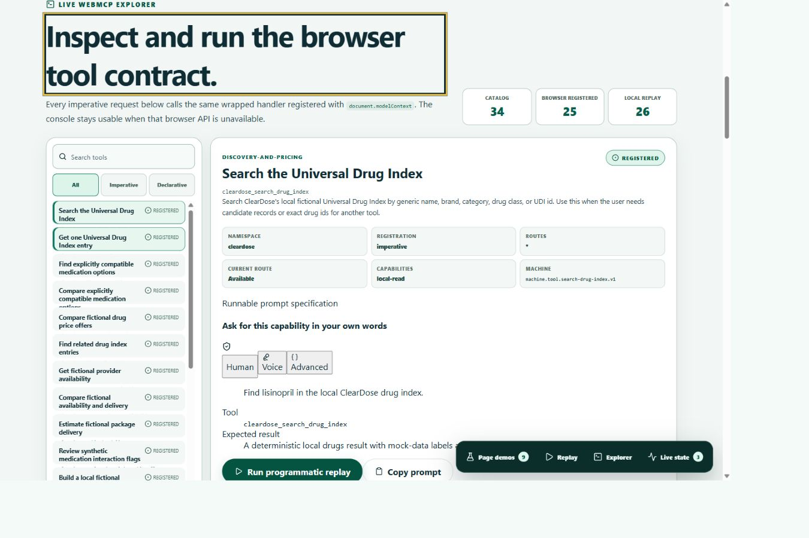
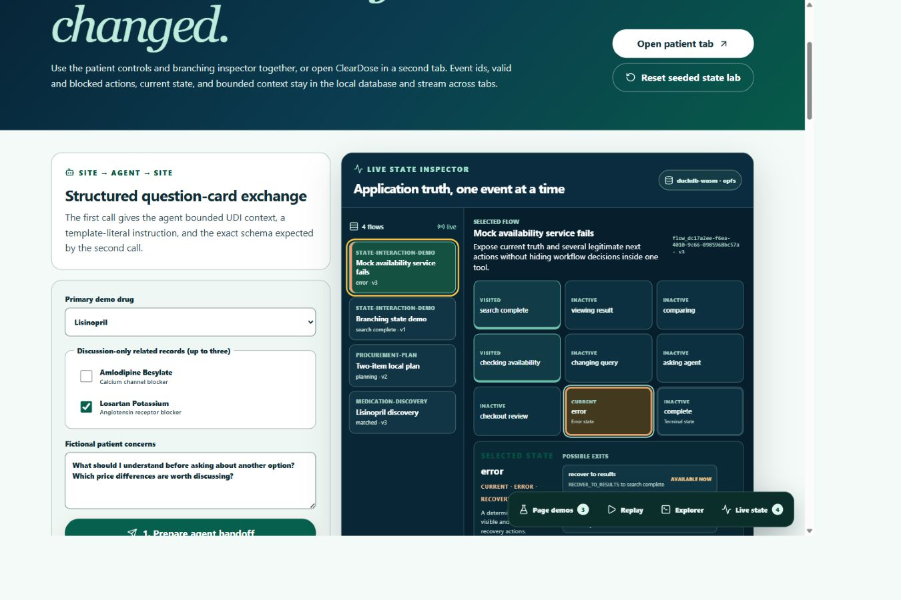

# ClearDose

Transparent prescriptions, agent-ready.

ClearDose is a fictional, local-only prescription shopping sandbox built with Vue 3. It shows how a person, a browser agent, and a deterministic replay can use the same typed application capabilities without scraping page text or bypassing visible human controls.



## Why WebMCP

Medication shopping needs exact package identity, explicit comparison rules, current workflow state, and clear approval boundaries. Generic DOM automation has to infer those facts from presentation. ClearDose exposes them as bounded capabilities through `document.modelContext.registerTool()`.

The visible UI, WebMCP tools, Explorer Try It console, and Programmatic Replay all call the same Pinia actions and application services. A tool cannot place an order, contact a clinician, send a prescription, or make a clinical decision.

## Main demo

The seeded patient journey can:

- search 52 fictional medication concepts and 156 exact packages;
- compare an exact package across four fictional providers;
- change among three mock locations and observe price and fulfillment changes;
- reject unrelated medication comparisons with a typed explanation;
- create a doctor discussion card that remains in human review;
- show legal, blocked, failure, and recovery transitions in a live state graph.

Three pieces recur across the site:

- Programmatic Replay runs the real local handlers with pause, resume, step, restart, reset, timing, and call inspection.
- The WebMCP Explorer documents and invokes the canonical 34-capability catalog.
- The Live State Inspector shows current state, version, event history, valid next actions, and recovery paths.





## Run locally

Node.js 22.13.0 or newer is required.

```bash
npm ci
npm run dev
```

Open `http://localhost:5173/#/`. The seeded sign-in is `demo@patient.test` with password `demo1234`. Both values are fictional and stay in the browser.

For a production-like local run:

```bash
npm run build
npm run start -- --host 127.0.0.1 --port 4173 --strictPort
```

Then open `http://127.0.0.1:4173/#/`.

The current hosted build is available at the [owner-only demo](https://cleardose-demo.bclonancode.chatgpt.site). It is not yet a public judge URL.

## Test

```bash
npm run lint
npm run typecheck
npm test
npm run evals:contracts
npm run build
npm run smoke:app
npm ls --depth=0
git diff --check
```

The final local release run passes 99 repository tests and validates 34 capabilities, 25 imperative tool contracts, 23 evaluation journeys, and 15 positive smoke journeys. The repository has no automated end-to-end browser suite or automated accessibility scanner. Those gaps remain explicit in [testing and release evidence](docs/TESTING.md).

## Demo scenarios

- [Six-minute judge path](docs/DEMO_GUIDE.md)
- `/#/demo`: invoke a seeded search, inspect schemas, run replay, and try a malformed request.
- `/#/compare`: compare Lisinopril 10 mg, quantity 60 in Baltimore and the remote mock location.
- `/#/flow-lab`: trigger `MOCK_SERVICE_FAILED`, inspect `RETRY_CHECK_AVAILABILITY`, and dispatch a legal recovery.
- `/#/studio`: author a safe local document capability, preview it, save a draft, and register it as a separate action.

The [role scenario matrix](docs/ROLE_SCENARIOS.md) maps every patient, clinician-discussion, agent, developer, and judge story to its evidence.

## Architecture

ClearDose keeps two connected local paths:

```text
Vue component or WebMCP tool
  -> Pinia action
  -> ClearDoseFacade
  -> repository adapter
  -> mock API and Universal Drug Index
  -> browser DAO

UI, WebMCP, or replay
  -> shared tool handler
  -> WorkflowRuntime
  -> DuckDB-Wasm and OPFS, with memory fallback
  -> BroadcastChannel
  -> Live State Inspector
```

Pages do not read seed files or persistence directly. The canonical capability manifest is `src/infrastructure/webmcp/catalog/capabilityCatalog.js`. The registered implementations are in `src/infrastructure/webmcp/tools/createDefaultTools.js`. See [architecture](docs/ARCHITECTURE.md), [WebMCP integration](docs/WEBMCP_PLUGIN.md), and [local workflow runtime](docs/LOCAL_WORKFLOW_RUNTIME.md).

## Documentation

- [Final release report](docs/FINAL_RELEASE_REPORT.md)
- [Finalization task board](docs/FINALIZATION_TASKBOARD.md)
- [Smoke test matrix](docs/SMOKE_TEST_MATRIX.md)
- [Submission checklist](docs/SUBMISSION_CHECKLIST.md)
- [Submission draft](docs/HACKATHON_SUBMISSION.md)
- [Accessibility target](docs/ACCESSIBILITY.md)
- [Mock API boundary](docs/MOCK_API.md)
- [Capability Studio](docs/CAPABILITY_STUDIO.md)
- [Evaluation contracts](docs/EVALS.md)
- [Agent and contributor guide](AGENTS.md)
- [Changelog](CHANGELOG.md)

## Safety boundary

Everything is fictional and stored only in the browser. ClearDose is not a pharmacy, medical device, clinical system, or care recommendation service. It does not accept real health information, contact providers, process payments, validate prescriptions, fulfill medication, or place real orders.
