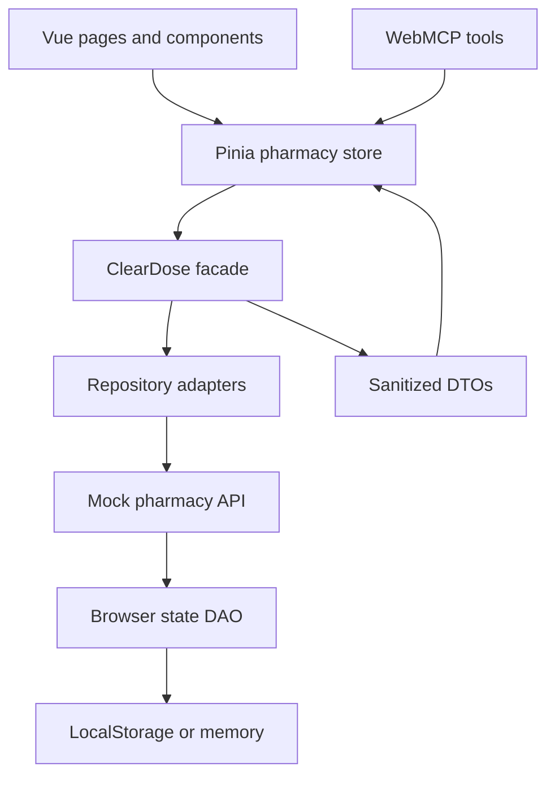

# Architecture

## Layer responsibilities

| Layer | Location | Responsibility |
|---|---|---|
| Presentation | `src/views`, `src/components` | Render DTOs, collect input, dispatch Pinia actions |
| Component adapters | `src/presentation`, `src/composables/useAgentReadyComponent.js` | Replace component behavior and compose component-scoped tools via props |
| Reactive state | `src/stores/pharmacyStore.js` | Hold UI state and make facade use cases reactive |
| Application | `src/application/facades` | Framework-independent use-case API shared by UI and agents |
| Domain transfer | `src/domain/dto` | Validate, clone, freeze, and sanitize data crossing layers |
| Repository adapters | `src/infrastructure/repositories` | Catalog, customer, cart, prescription, and order persistence behavior |
| API services | `src/services/api` | Isolated mock server behavior and fictional seed fixtures |
| DAO | `src/infrastructure/persistence` | Serialize/reset the complete mock state |
| Accessibility services | `src/services/accessibility` | Route guidance and replaceable speech-synthesis adapter |
| UI services | `src/services/ui` | Shared focus, scroll, and section highlighting for people and agents |
| Agent transport | `src/infrastructure/webmcp` | Register, namespace, execute, diagnose, and unregister tools |
| Composition root | `src/app/createClearDosePlugin.js` | Wire Pinia, facade, adapters, component registry, and default tools |

## Mutation path

UI components and WebMCP tools both invoke Pinia actions. The action delegates to the facade, the facade coordinates repository adapters, and adapters call the isolated API service. The DAO persists one state transaction, then Pinia refreshes from sanitized DTOs.

## Swapping implementations

- Replace `createClearDoseBrowserAdapter()` with an HTTP or IndexedDB adapter implementing the same repository methods.
- Pass a custom `dataAdapter`, `facade`, `webMcpAdapter`, or `toolRegistry` into `createClearDosePlugin()`.
- Pass `adapter`, `mcpTools`, `mcpContext`, and `registerMcp` to any reusable component.
