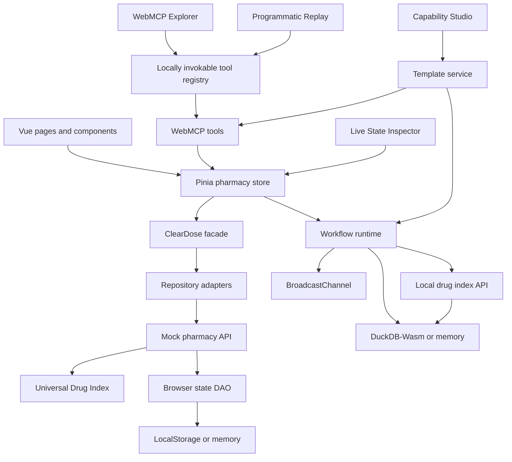

# Architecture

## Layer responsibilities

| Layer | Location | Responsibility |
|---|---|---|
| Presentation | `src/views`, `src/components` | Render DTOs, collect input, dispatch Pinia actions |
| Component adapters | `src/presentation`, `src/composables/useAgentReadyComponent.js` | Replace component behavior and compose component-scoped tools via props |
| Reactive state | `src/stores/pharmacyStore.js` | Hold UI state and make facade use cases reactive |
| Application | `src/application/facades` | Framework-independent use-case API shared by UI and agents |
| Domain transfer | `src/domain/dto` | Validate, clone, freeze, and sanitize data crossing layers |
| Repository adapters | `src/infrastructure/repositories` | Catalog, customer, cart, prescription, and order persistence behavior |
| API services | `src/services/api` | Isolated mock server behavior and fictional seed fixtures |
| Local drug API | `src/services/api/local/LocalDrugIndexApi.js` | Query the configured seeded workflow DAO without coupling tools to DuckDB |
| Universal Drug Index | `src/services/api/udi` | Normalized identity, explicit comparison relationships, generated packages and provider offers, mock locations, availability, delivery, clinical sample facts, synthetic review flags, and local procurement planning |
| DAO | `src/infrastructure/persistence` | Serialize/reset the complete mock state |
| Workflow definitions | `src/services/api/workflows` | Branching state charts, action schemas, human-only flags, recovery metadata, and template-literal structured exchange contracts |
| Workflow runtime | `src/services/workflows` | Inspect current truth, validate versioned transitions, capture bounded context, coordinate structured exchanges, and mirror tabs |
| Workflow persistence | `src/infrastructure/persistence/DuckDbWasmDao.js` | Seed drugs and store flows, events, exchanges, and cards in DuckDB-Wasm/OPFS with explicit memory fallback |
| Accessibility services | `src/services/accessibility` | Route guidance and replaceable speech-synthesis adapter |
| UI services | `src/services/ui` | Stable section highlighting, bounded observations, and visible declarative form invocation |
| Demo scenarios | `src/services/api/demos` | Frozen prompts, expected results, mock labels, capability references, steps, observations, and recovery links |
| Replay runtime | `src/services/workflows/ProgrammaticReplayRuntime.js` | Resolve step inputs, invoke the shared tool registry, capture timing and bounded diffs, and coordinate replay controls |
| Template service | `src/services/templates` | Validate, render, persist, and explicitly register non-executable user-authored tools/workflows |
| Agent transport | `src/infrastructure/webmcp` | Register, namespace, execute, diagnose, and unregister tools |
| Capability catalog | `src/infrastructure/webmcp/catalog` | Canonical names, categories, schemas, permissions, prompt variants, errors, routes, related tools, scenarios, and machine ids |
| User-controlled files | `src/services/files` | Explicit clipboard/File System Access/download adapters for reviewed artifacts |
| Composition root | `src/app/createClearDosePlugin.js` | Wire Pinia, facade, adapters, component registry, and default tools |

## Mutation path

UI components and WebMCP tools both invoke Pinia actions. The action delegates to the facade. Catalog reads and domain workflows query the centralized UDI through the mock API. Cart, customer, and order mutations continue through repository adapters and the browser DAO. Pinia refreshes mutable state from sanitized DTOs after a mutation.

Imperative UDI search/detail tools take a second local-first path: `tool → Pinia → WorkflowRuntime → LocalDrugIndexApi → DuckDbWasmDao`. That makes the seeded `drugs` table observable and replaceable while the facade remains the source for synchronous human UI reads. The DAO's memory adapter implements the same query port.

The observability path is parallel and non-clinical. UI actions, WebMCP execution wrappers, replay hooks, and deterministic failure fixtures call `WorkflowRuntime`. Every transition is checked against a centralized definition and action-specific schema. Agent dispatch also requires the currently observed version and a unique request id. The runtime assigns an event id, persists a bounded context snapshot, and publishes the event to same-origin tabs. The Live State Inspector only consumes the reactive Pinia snapshot. Pages never query DuckDB directly.

Programmatic Replay does not reimplement demo behavior. A scenario names capability ids and structured inputs. The replay runtime resolves prior-step references, then calls `WebMcpToolRegistry.invoke()`. Browser registration and local invocation reach the same handler. `BoundedObservationService` records only named readers and stable DOM targets, so request traces never depend on unrestricted page scraping.

The WebMCP Explorer reads the canonical catalog and the registry snapshot. Its Try It console invokes imperative handlers through the registry and declarative tools through visible forms. It displays the resulting structured response, elapsed time, and bounded before/after state. The Explorer does not bypass Pinia or create a separate API path.

Every built-in capability has a static machine descriptor. Shortcut and user-authored workflow runs embed a validated dynamic definition in flow context so they survive persistence without schema migration. Dynamic definitions require unique snake_case states and an explicit `{ role, situation, step }` scope. User document tools enter the same queued, running, complete, or error wrapper and create a separate artifact in human review.

Comparison eligibility is data, not a UI guess. `ComparisonCompatibilityIndex` owns explicit relationships and purpose-specific permissions for fact, price, fulfillment, and doctor-discussion views. Provider, location, inventory, and delivery fixtures live beside the UDI. Pages and tools receive DTOs or structured application results. They do not duplicate these rules.

## Swapping implementations

- Replace `createClearDoseBrowserAdapter()` with an HTTP or IndexedDB adapter implementing the same repository methods.
- Pass a custom `dataAdapter`, `facade`, `webMcpAdapter`, or `toolRegistry` into `createClearDosePlugin()`.
- Pass a custom `workflowDao` or `workflowRuntime` to run the observability layer against another local adapter.
- Pass `adapter`, `mcpTools`, `mcpContext`, and `registerMcp` to any reusable component.
- Pass a custom `capabilityTemplateDao` or `capabilityTemplateService` to replace local persistence or authoring policy.
