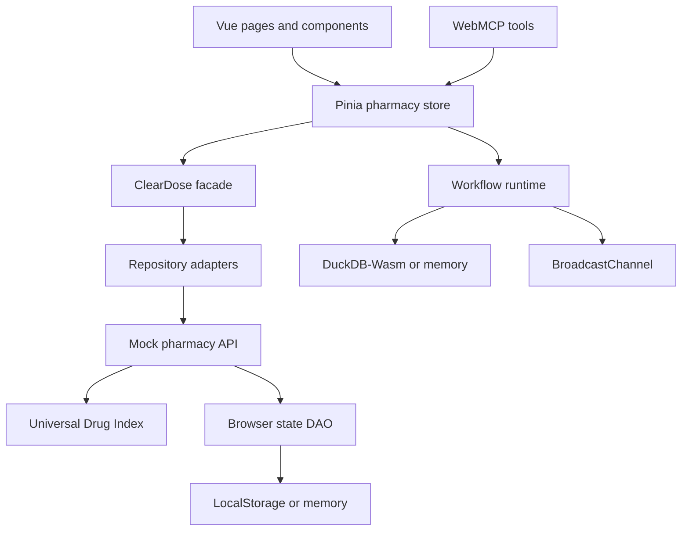

# Architecture

## Layer responsibilities

| Layer | Location | Responsibility |
|---|---|---|
| Presentation | `src/views`, `src/components` | Render DTOs, collect input, dispatch Pinia actions |
| Component adapters | `src/presentation`, `src/composables/useAgentReadyComponent.js` | Replace component behavior and compose component-scoped tools via props |
| Reactive state | `src/stores/pharmacyStore.js` | Hold UI state and make facade use cases reactive |
| Application | `src/application/facades` | Framework-independent use-case API shared by UI and agents |
| Domain transfer | `src/domain/dto` | Validate, clone, freeze, and sanitize data crossing layers |
| Repository adapters | `src/infrastructure/repositories` | Catalog, customer, cart, prescription, and order persistence behavior |
| API services | `src/services/api` | Isolated mock server behavior and fictional seed fixtures |
| Universal Drug Index | `src/services/api/udi` | Normalized identity, generated packages/offers, broad related groups, synthetic review flags, local procurement planning |
| DAO | `src/infrastructure/persistence` | Serialize/reset the complete mock state |
| Workflow definitions | `src/services/api/workflows` | State charts and template-literal structured exchange contracts |
| Workflow runtime | `src/services/workflows` | Validate transitions, capture bounded context, coordinate structured exchanges, and mirror tabs |
| Workflow persistence | `src/infrastructure/persistence/DuckDbWasmDao.js` | Seed drugs and store flows, events, exchanges, and cards in DuckDB-Wasm/OPFS with explicit memory fallback |
| Accessibility services | `src/services/accessibility` | Route guidance and replaceable speech-synthesis adapter |
| UI services | `src/services/ui` | Shared focus, scroll, and section highlighting for people and agents |
| Agent transport | `src/infrastructure/webmcp` | Register, namespace, execute, diagnose, and unregister tools |
| Composition root | `src/app/createClearDosePlugin.js` | Wire Pinia, facade, adapters, component registry, and default tools |

## Mutation path

UI components and WebMCP tools both invoke Pinia actions. The action delegates to the facade. Catalog reads and domain workflows query the centralized UDI through the mock API; cart, customer, and order mutations continue through repository adapters and the browser DAO. Pinia refreshes mutable state from sanitized DTOs after a mutation.

The observability path is parallel and intentionally non-clinical. UI actions, WebMCP execution wrappers, and deterministic failure fixtures call `WorkflowRuntime`. Every transition is validated against a centralized state definition, assigned an event id, persisted with a bounded context snapshot, and published to same-origin tabs. The live viewer only consumes the reactive Pinia snapshot; pages never query DuckDB directly.

## Swapping implementations

- Replace `createClearDoseBrowserAdapter()` with an HTTP or IndexedDB adapter implementing the same repository methods.
- Pass a custom `dataAdapter`, `facade`, `webMcpAdapter`, or `toolRegistry` into `createClearDosePlugin()`.
- Pass a custom `workflowDao` or `workflowRuntime` to run the observability layer against another local adapter.
- Pass `adapter`, `mcpTools`, `mcpContext`, and `registerMcp` to any reusable component.
