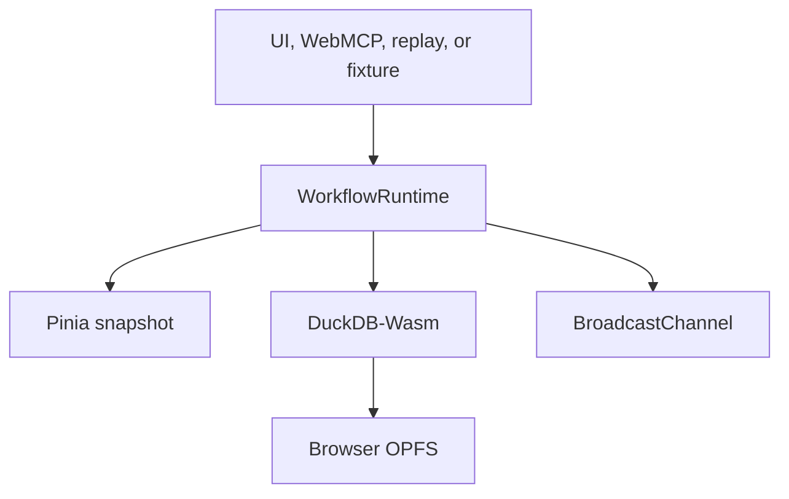

# Local workflow runtime

ClearDose includes a local observability layer for human UI actions, WebMCP calls, Programmatic Replay, structured exchanges, and executable deterministic failure fixtures. Open `/#/flow-lab` or the persistent Demo Lab to use it.

## Runtime path

`WorkflowRuntime` is the only transition coordinator. It validates each action against `workflowDefinitions`, checks the action-specific input schema, checks the expected state version and request id, merges a bounded context snapshot, creates an event id, updates the flow instance, persists both rows, and notifies subscribers. The Vue viewer reads Pinia only. It never imports DuckDB or fixtures.

## Local tables

| Table | Purpose |
|---|---|
| `drugs` | 52 preseeded fictional UDI records with 156 packages and 624 provider offers |
| `flow_instances` | Current state, status, context, timestamps, and event count per concurrent flow |
| `flow_events` | Immutable transition history with event id, source, correlation id, and context at that step |
| `agent_exchanges` | Bounded site instruction, request context, exact response schema, and exchange status |
| `generated_cards` | Patient-reviewable question cards and memory packet artifacts plus review/export state |

The database opens at `opfs://cleardose-flow-lab.duckdb` and checkpoints writes. ClearDose uses DuckDB's official `getJsDelivrBundles()` and `selectBundle()` bootstrap so the browser receives the compatible engine and worker without putting 34 to 39 MB binaries into the Site artifact. Engine assets require an initial jsDelivr fetch. SQL execution and all OPFS data remain local to the browser after loading.

## Cross-tab behavior and fallback

Each transition, exchange, and card is published over a same-origin `BroadcastChannel`. The receiving tab applies the same id and payload to its local runtime and viewer. Browser OPFS may allow only one writable owner; if engine loading, initialization, or file access fails, that tab visibly reports `memory-fallback` and continues to receive live channel events. The patient experience and WebMCP tools remain usable.

The fallback is intentionally explicit: it does not claim persistence, and its status includes the failure reason. No remote database is contacted.

## Branching state interaction

`state-interaction-demo` begins at `search_complete`. The definition declares branches for viewing one result, comparing compatible options, checking seeded availability, changing the query, asking an agent, and opening checkout review. Error and recovery edges are declared too. `START_CHECKOUT` and final review actions are human-only.

The state tools split observation from action:

| Tool | Behavior |
|---|---|
| `cleardose_inspect_workflow_state` | Return current state, version, state metadata, and action groups |
| `cleardose_get_workflow_history` | Return bounded chronological events with stable versions |
| `cleardose_get_available_workflow_actions` | Separate valid agent actions, human-only actions, and unavailable actions |
| `cleardose_get_workflow_transition` | Explain one branch and its input schema without dispatching it |
| `cleardose_dispatch_workflow_transition` | Apply one valid agent action against the observed version and request id |
| `cleardose_reset_workflow_state` | Return to the declared initial state and append a reset event |

Dispatch rejects unknown actions, invalid transition input, stale versions, duplicate request ids, terminal states, and human-only actions. The error includes a stable code and bounded details. The caller must inspect current truth again before recovering from `STALE_STATE_VERSION`.

The Live State Inspector draws from the definition's nodes and edges. It marks the current state, terminal and error states, valid branches, disabled branches, and recovery paths. Selecting an edge shows its trigger, input contract, target, human-control status, and related tool. The event list stays chronological and labels the source category.

## Programmatic Replay

`ProgrammaticReplayRuntime` runs frozen scenarios from `src/services/api/demos/demoScenarios.js`. Each tool step invokes `WebMcpToolRegistry.invoke()`, the same executor used for browser registration. The replay records the resolved request, structured response or typed error, elapsed time, mock label, stable highlight target, and changes reported by named bounded observers.

The replay has `ready`, `running`, `paused`, `complete`, and `error` states. Run, pause, resume, single-step, restart, and reset update a matching `programmatic-replay` workflow so the inspector can explain the demo itself. Restart begins the selected scenario again. Reset clears replay output and restores the deterministic demo seed.

`BoundedObservationService` reads declared application summaries and stable DOM ids or counts. It never records unrestricted page text, input values, passwords, or external browser state.

## Structured exchange sequence

1. `prepare_doctor_question_card_request` resolves trusted UDI facts, records a flow, and returns the `exchangeId`, bounded context, template-literal instruction, response tool name, and closed JSON Schema.
2. The agent calls `submit_doctor_question_card_draft` with the exchange id, a neutral title, and two to eight question-shaped strings.
3. Runtime validation rejects unknown exchanges, repeat submissions, extra fields, non-question text, and out-of-range arrays.
4. ClearDose derives all displayed fictional price facts from the original request context and renders a local draft.
5. The patient can edit upstream input, print/copy the card, and explicitly mark it reviewed. No medication change, provider message, or order occurs.

## Adding a flow

Add one state definition under `src/services/api/workflows`, expose a Pinia action that calls `startFlow()` and `transition()`, and add deterministic tests for valid/invalid target states and bounded context. Pages should only select the use case and render the result.

For a situation-specific machine, call `startDynamicMachine({ id, title, states, scope, context })`. `scope` must include `role`, `situation`, and `step`; states must be unique snake_case strings. The runtime embeds the definition in context, persists it with the flow, and the live viewer resolves it without importing route-specific code. `startShortcut()` is the reference adapter.

Every imperative call is also represented by a four-state machine from the capability catalog. Declarative forms emit a privacy-minimized machine containing field names, never values, plus `valuesPersisted: false`.

## Prescription and memory sequences

Prescription recovery moves `blocked → preparing → human_review`. Its context records the error code, recommended follow-up tool, editable prompt, and `externalActionTaken: false`. A person must initiate any later copy, provider contact, or tool call.

Capability Studio workflows register validated dynamic definitions under `user-workflow-<name>`. Each run embeds its definition, input, rendered guide, template id, and declared scope in bounded context. Studio document tools use the normal tool execution machine and create a separate `dynamic-document` artifact in `human_review`.

Memory preparation moves `drafting → human_review`. An explicit clipboard or file action records `USER_EXPORTED_MEMORY` and moves to `exported`. The browser file picker is invoked before asynchronous work so it retains the required user activation; unsupported browsers receive an ordinary Markdown download.

## Privacy boundary

Use fictional data only. Do not put passwords, real patient data, unrestricted DOM text, or model conversation history into event context. The runtime is an explanatory development surface, not an audit log, clinical record, or regulated system.
