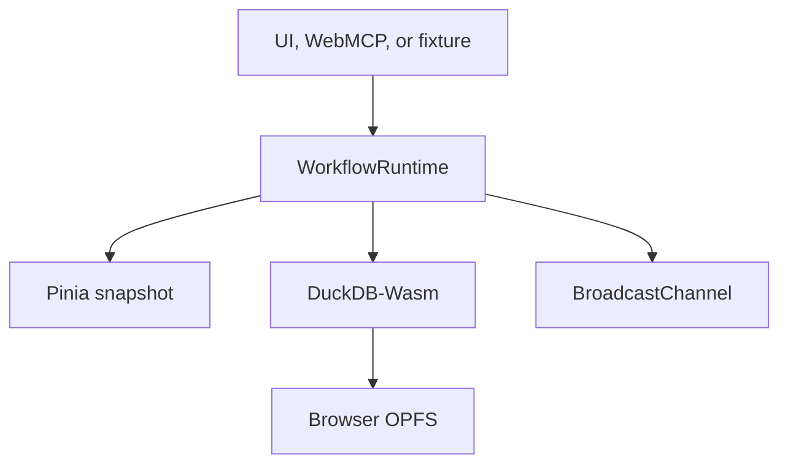

# Local workflow runtime

ClearDose includes a local observability layer for human UI actions, WebMCP calls, structured exchanges, and deterministic failure fixtures. Open `/#/flow-lab` to use it.

## Runtime path

`WorkflowRuntime` is the only transition coordinator. It validates the target against `workflowDefinitions`, merges a bounded context snapshot, creates an event id, updates the flow instance, persists both rows, and notifies subscribers. The Vue viewer reads Pinia only; it never imports DuckDB or fixtures.

## Local tables

| Table | Purpose |
|---|---|
| `drugs` | 52 preseeded fictional UDI records with their package/offer payload |
| `flow_instances` | Current state, status, context, timestamps, and event count per concurrent flow |
| `flow_events` | Immutable transition history with event id, source, correlation id, and context at that step |
| `agent_exchanges` | Bounded site instruction, request context, exact response schema, and exchange status |
| `generated_cards` | Patient-reviewable question card drafts and review state |

The database opens at `opfs://cleardose-flow-lab.duckdb` and checkpoints writes. DuckDB-Wasm, its worker, and WASM modules are emitted by Vite and served from the same deployment—there is no runtime CDN dependency.

## Cross-tab behavior and fallback

Each transition, exchange, and card is published over a same-origin `BroadcastChannel`. The receiving tab applies the same id and payload to its local runtime and viewer. Browser OPFS may allow only one writable owner; if initialization or file access fails, that tab visibly reports `memory-fallback` and continues to receive live channel events. The patient experience and WebMCP tools remain usable.

The fallback is intentionally explicit: it does not claim persistence, and its status includes the failure reason. No remote database is contacted.

## Structured exchange sequence

1. `prepare_doctor_question_card_request` resolves trusted UDI facts, records a flow, and returns the `exchangeId`, bounded context, template-literal instruction, response tool name, and closed JSON Schema.
2. The agent calls `submit_doctor_question_card_draft` with the exchange id, a neutral title, and two to eight question-shaped strings.
3. Runtime validation rejects unknown exchanges, repeat submissions, extra fields, non-question text, and out-of-range arrays.
4. ClearDose derives all displayed fictional price facts from the original request context and renders a local draft.
5. The patient can edit upstream input, print/copy the card, and explicitly mark it reviewed. No medication change, provider message, or order occurs.

## Adding a flow

Add one state definition under `src/services/api/workflows`, expose a Pinia action that calls `startFlow()` and `transition()`, and add deterministic tests for valid/invalid target states and bounded context. Pages should only select the use case and render the result.

## Privacy boundary

Use fictional data only. Do not put passwords, real patient data, unrestricted DOM text, or model conversation history into event context. The runtime is an explanatory development surface, not an audit log, clinical record, or regulated system.

